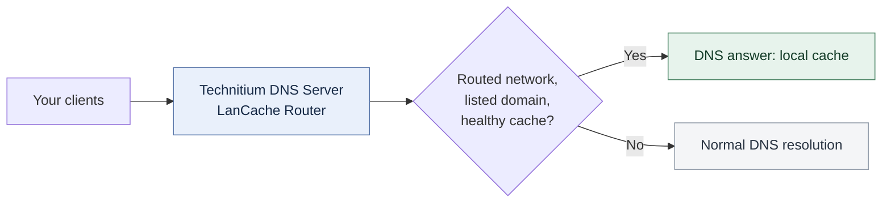

# LanCache Router

**Local downloads. The right cache for each network.**

Put your [LanCache](https://lancache.net/) to work from inside [Technitium DNS Server](https://technitium.com/dns/). Choose which client networks use each cache, add a standby if you have one, and let health checks keep unavailable servers out of new DNS answers.

**[Get started](docs/wiki/03-installation.md)** · [Documentation](docs/wiki/README.md) · [Releases](https://github.com/JohannesPosch/Technitium-LanCache-Router/releases)

---

## Downloads that fit your network

A game room, a guest VLAN, and a server network may all need different paths to the internet. LanCache Router lets you give each network the cache it can reach, while leaving other clients on normal DNS.

| Choose the network | Keep a fallback | Stay up to date |
| :--- | :--- | :--- |
| Route clients by subnet, with exceptions for individual devices. | Use the first healthy cache in your preference list. If none is available, let Technitium resolve normally. | Refresh the community cache-domain list on a schedule, with your own additions and exclusions. |



The app makes the DNS decision; clients download directly from your cache. You still need a working LanCache server. Cache addresses are IPv4, and clients must use this Technitium server for the relevant DNS lookups.

## Start with one cache

Install `LanCacheRouter.zip` from a compatible release through Technitium's **Apps** page, then open the app's **Config**. Replace the example cache address and client subnet below with yours:

```json
{
  "enabled": true,
  "cacheServers": [
    { "name": "cache-1", "address": "192.168.17.44" }
  ],
  "routes": [
    {
      "priority": 10,
      "sourceCidr": "192.168.17.0/24",
      "servers": ["cache-1"]
    }
  ]
}
```

This uses the default HTTP health check on port 80 at `/lancache-heartbeat`. Once the cache passes its startup checks and the domain list is available, clients in `192.168.17.0/24` receive its address for matching download domains. Other lookups follow normal DNS resolution.

> **First install?** The packaged configuration starts disabled. Follow the [installation guide](docs/wiki/03-installation.md) to check compatibility, preserve client addresses, and verify your first answer.

Health changes affect new DNS answers. Clients may retain an earlier answer for its TTL, which defaults to 60 seconds; existing downloads are not moved between servers.

## Make it yours

| Next step | Guide |
| :--- | :--- |
| Give each VLAN a cache or add a standby | [Routing](docs/wiki/05-routing.md) |
| Adjust checks and recovery timing | [Health checks](docs/wiki/06-health-checks.md) |
| Select services or add download domains | [Domain list](docs/wiki/07-domain-list.md) |
| Look up a setting | [Configuration reference](docs/wiki/04-configuration-reference.md) |
| Find out why a client bypasses the cache | [Troubleshooting](docs/wiki/09-operations.md) |

The [wiki](docs/wiki/README.md) also covers DNS behavior, clustering, and [current limits](docs/wiki/10-limitations-and-roadmap.md).

## Build and contribute

Building requires the .NET 10 SDK and the Technitium assemblies from your target server in `lib/`. The [build instructions](docs/wiki/03-installation.md#build-the-package) cover collecting them and packaging the app.

```bash
dotnet test -c Release
dotnet publish src/LanCacheRouter -c Release -o out
```

Application code lives in [`src/LanCacheRouter`](src/LanCacheRouter), with tests in [`tests/LanCacheRouter.Tests`](tests/LanCacheRouter.Tests). The [design records](docs/adr/README.md) explain the architecture; the [backlog](docs/backlog.md) records deferred features.

For a bug report, include your Technitium and app versions, a configuration with private details removed, and the relevant `LanCache Router:` log lines. For a feature request, describe the network or download problem you want to solve.

Licensed under the [MIT License](LICENSE).
