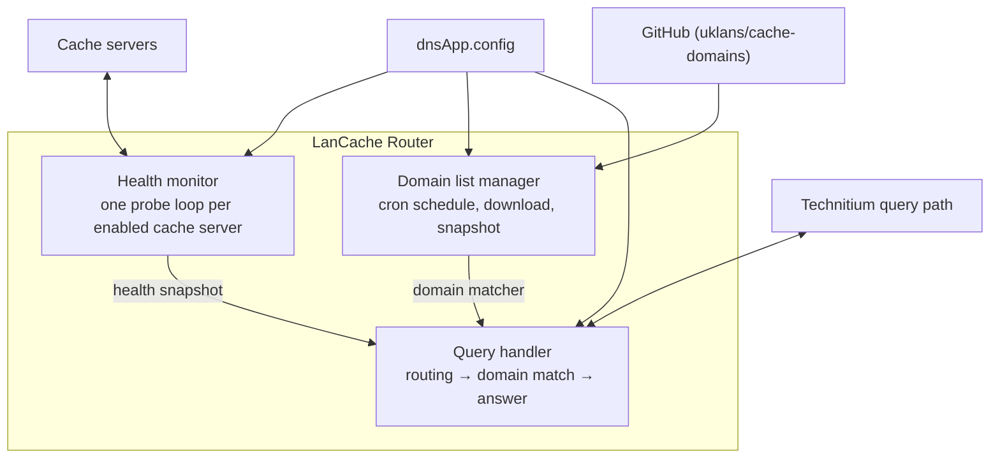
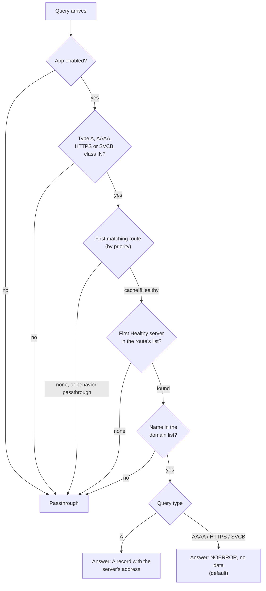

# 2. How it works

## The app inside Technitium

Technitium lets apps take part in query processing. LanCache Router registers as a **request blocking handler**
(the same hook the *Advanced Blocking* app uses). Technitium calls it for each query **before** it looks in its own
cache or asks any upstream server. The app either returns a finished answer or returns "nothing", in which case
Technitium carries on as usual.

Three things run in the background, independent of queries:

The query handler never blocks on the network: it reads the latest *health snapshot* and *domain matcher*, which the
background parts replace atomically. A query therefore costs a few table lookups.

## What happens to one query

In words:

1. **Enabled?** If `enabled` is false (or there is no valid configuration yet) nothing happens.
2. **Type and class.** Only `A`, `AAAA`, `HTTPS` and `SVCB` queries of class `IN` are considered. Everything else
   (MX, TXT, NS, PTR, …) is left to Technitium.
3. **Route.** The client address is matched against the routing table, lowest priority number first; the first
   matching row wins. No match, or a row with behavior `passthrough`, means passthrough.
4. **Server.** A `cacheIfHealthy` row walks its `servers` list in order and uses the first server that is **Healthy**.
   If none is Healthy, the query is passed through.
5. **Domain.** The query name is looked up in the domain list. Not a cache domain → passthrough.
6. **Answer.** The app builds the response (see [DNS answers](08-dns-answers.md)).

> **The order matters for cost and for logging.** The route is checked before the domain, so a client that is not
> routed never causes a domain lookup, and a query for a non-cache domain never appears in the per-query log.

## Fail-open

The app is built so that a problem inside it does not become a DNS outage:

- any unexpected exception while handling a query is logged and the query is passed through;
- a configuration that does not validate is rejected, and the previous configuration keeps running;
- if no domain list is available yet (first start, GitHub unreachable), no name matches, so everything is passed through;
- a cache server that is not Healthy is never handed out.

## Technitium's own rules still apply first

The app only sees a query if Technitium would otherwise have sent it into recursive resolution. In particular:

- **Local zones win.** If the name is served by an authoritative zone on the Technitium server (or another app
  answers it first), the app is never asked. A cache domain you also created as a zone will not be rewritten.
- **Recursion must be allowed.** Queries need the *recursion desired* bit, and the client must be allowed to use
  recursion (Technitium's *Allow Recursion* settings). Clients Technitium would refuse are refused before the app is asked.
- **Other blocking apps.** Technitium asks each blocking handler in order of its *preference* number. This app uses
  `150`, Advanced Blocking uses the default `100`, so **blocked domains stay blocked** and an *allow* rule in
  Advanced Blocking makes Technitium skip the app for that query.
- **Real client address.** Routing uses the client address Technitium sees. Behind Docker bridge networking or a
  proxy that hides it, every client looks the same. See [Installation](03-installation.md#client-addresses).

## Time and state

| What | Where it lives | Survives a restart? |
|---|---|---|
| Configuration | `dnsApp.config` (replicated by Technitium clustering) | yes |
| Health states and probe counters | memory, **per node** | no – every server starts as *Unknown* |
| Domain list | memory, plus a snapshot file in the app folder (**per node**) | yes (snapshot) |
| Routing table, compiled domain matcher | memory | rebuilt at start |

Stale health is never trusted: after a restart a server is *Unknown* and is not used until its first probes succeed
(a few seconds, see [Health checks](06-health-checks.md#startup-behavior)).

## Reconfiguration

Technitium re-initializes the app on every configuration save, on the same running instance:

- the configuration is validated first; if it is invalid the save fails with the list of problems and nothing changes;
- the routing table and DNS settings switch over atomically;
- cache servers whose **address and effective health check are unchanged keep their state and probing**; new or
  changed servers restart as *Unknown*; removed or disabled servers stop being probed;
- the domain list is rebuilt from the list already in memory with the new filters, **without downloading**, unless
  the `baseUrl` changed (see [Domain list](07-domain-list.md#when-the-list-is-downloaded)).
