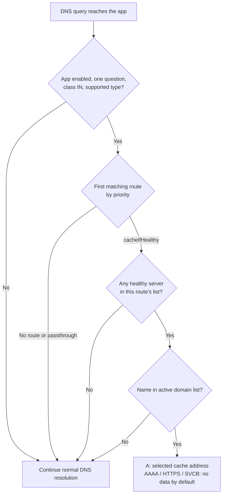

# How it works

[Documentation](README.md) / How it works

Each lookup uses three pieces of information: the client's route, the current health of its cache servers, and the active domain list. Health checks and downloads run in the background, so answering a query never waits for a probe or a list download.

## What happens to one query

The supported types are `A`, `AAAA`, `HTTPS`, and `SVCB`, in class `IN`. For eligible queries, the app checks enabled routes in ascending priority order. The first matching route wins, even if a later route is more specific.

Within that route, the first **Healthy** server is selected. If every listed server is unavailable, evaluation ends with passthrough; the app does not try another route. After a domain match, it builds the appropriate [DNS answer](08-dns-answers.md). The AAAA and HTTPS/SVCB modes can also be set to passthrough.

## How it fits into Technitium

The app uses Technitium's request blocking handler interface to provide answers before the recursive resolver cache. Despite the interface name, the app uses it to direct eligible downloads to a cache.

Several Technitium rules affect whether a query reaches this handler:

| Existing behavior | Effect |
| :--- | :--- |
| A local authoritative zone answers the name | That zone's answer takes precedence. |
| Recursion is not requested or is not allowed for the client | The query does not reach this app's resolution path. |
| Another blocking handler answers first | Its answer wins. LanCache Router uses preference `150`, after handlers using the default `100`. |
| A blocking app allows or bypasses the query | Technitium can skip the blocking pipeline, including LanCache Router. |
| NAT or a proxy hides the source address | Routing sees that translated address. EDNS Client Subnet is not used. |

For Advanced Blocking, this means blocks stay effective, while an allow rule can also bypass cache routing. See [client addresses](03-installation.md#client-addresses) when running behind containers or proxies.

## When something is unavailable

An unavailable cache is skipped. An unavailable domain source leaves the last successfully downloaded list active. If no usable list has ever been loaded, all names pass through, including configured extra domains until a list is available.

An unexpected query-handling exception is logged and the query is passed through. An invalid configuration is rejected before it replaces the running configuration. Passthrough always means Technitium continues with its own zones, blocking rules, cache, and upstream settings; it does not guarantee a public CDN address.

## Restarts and configuration changes

| State | After a restart | After a configuration save |
| :--- | :--- | :--- |
| Routes and DNS settings | Rebuilt from `dnsApp.config`. | Replaced together for query handling. |
| Cache health | Starts Unknown; startup probes run. `type: none` starts Healthy. | Preserved for the same named server when its address and effective check are unchanged. |
| Domain list | Loads the node's saved snapshot, if usable. | Reuses and re-filters the list already in memory. A changed source triggers a download. |

Changing a server's address or effective health check restarts that server's health tracking. Disabling the app stops probing and list downloads; re-enabling starts health tracking again and applies the startup refresh rules.

In a cluster, Technitium distributes the app and configuration. Each node maintains its own probes and domain snapshot, so nodes can briefly make different decisions. Every node needs access to the same configured cache addresses and domain source.

---

**Continue:** [Routing](05-routing.md) · [Health checks](06-health-checks.md) · [DNS answers](08-dns-answers.md)
