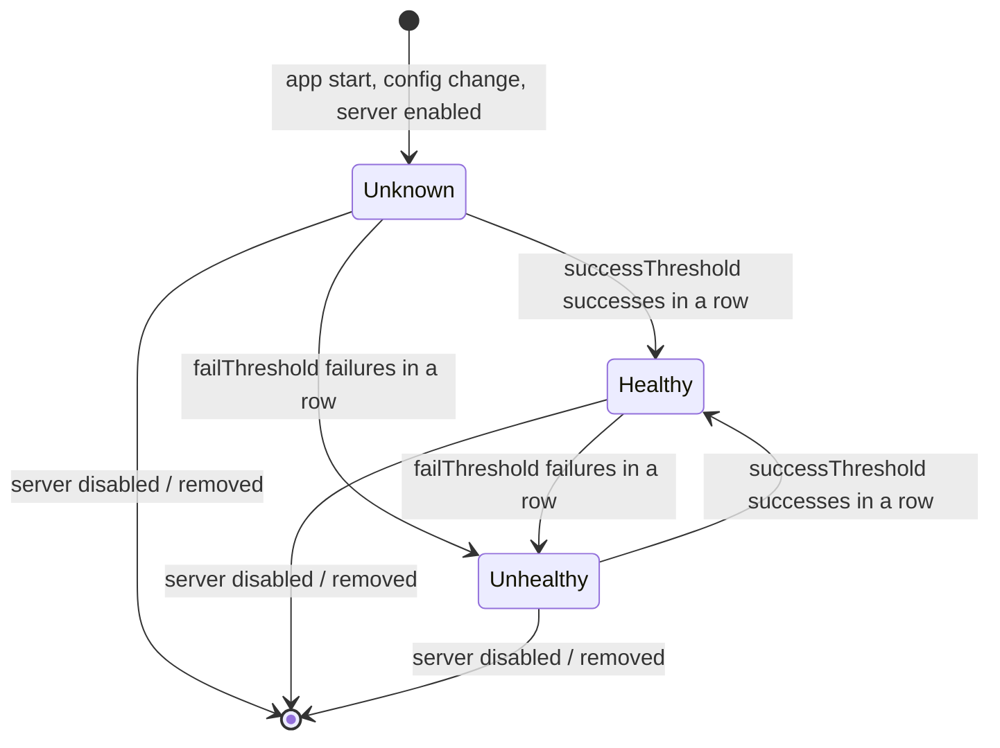

# 6. Health checks

Every **enabled** cache server is probed in the background. The result decides whether the server's address may appear in
DNS answers.

## States

| State | Meaning | Handed out in DNS? |
|---|---|---|
| **Unknown** | Starting up, or waiting for the first conclusive probe results. | **No** |
| **Healthy** | Passed `successThreshold` consecutive probes. | **Yes** |
| **Unhealthy** | Failed `failThreshold` consecutive probes. | **No** |
| **Disabled** | `enabled: false` on the server. Not probed. | **No** |



Important properties:

- **Hysteresis.** One failed probe does not take a Healthy server out of service, and one successful probe does not bring
  an Unhealthy server back. With the defaults it takes 2 failures (≈ 20 s) to go out and 3 successes (≈ 30 s) to come back.
- A success in between failures **resets the failure count** (and the other way around): the counts are *consecutive*.
- **Nothing is remembered across restarts.** After a restart every server is Unknown until proven healthy again.
- **Unknown is never served.** There is no optimistic mode.
- **Disabled** is not a probe result but an administrative decision. A disabled server has no probe loop at all.

## Probe types

| `type` | What is checked | Typical use |
|---|---|---|
| `tcp` | A TCP connection to `address:port` can be opened. Nothing is sent. | Cheapest; proves the port is open. |
| `http` | `GET http://address:port/path` returns one of `expectedStatus`. | Proves nginx answers. Default path `/lancache-heartbeat` returns `204` on the monolithic container. |
| `https` | The same over TLS. **Certificates are not validated** (the server is addressed by IP; only liveness is checked). | Caches behind TLS. |
| `none` | Nothing is sent. The server is **Healthy from the moment it is configured** (it skips *Unknown*) and stays so. | Testing, or targets you cannot probe. |

Probe details:

- A probe that takes longer than `timeoutSeconds` counts as a **failure**; so does any error (refused, unreachable,
  reset, TLS failure, unexpected exception).
- HTTP probes send `User-Agent: LanCacheRouter-HealthCheck` and **do not follow redirects**.
- The probe uses the **same address** that is returned to clients. It tests reachability from the DNS server, which is
  not necessarily the clients' point of view – if clients sit behind a firewall that the DNS server does not, the probe
  cannot see that.

## Timing

| Setting | Default | Meaning |
|---|---|---|
| `intervalSeconds` | 10 | pause between two probes of a server |
| `timeoutSeconds` | 2 | max duration of one probe; must not exceed the interval |
| `failThreshold` | 2 | failures in a row → Unhealthy |
| `successThreshold` | 3 | successes in a row → Healthy |

Time to react ≈ `failThreshold × intervalSeconds` (plus up to one interval for the next probe to run) to *stop* using a
failing cache, and `successThreshold × intervalSeconds` to *resume* using a recovered one. Add the DNS `ttl` (default
60 s): clients may keep the old answer that long. To react faster, lower `intervalSeconds` and `dns.ttl` together.

### Startup behavior

When the app starts (or a server is added or changed), with `startupProbe.enabled` (default):

1. the server is probed **immediately**;
2. while the server is still **Unknown**, probing continues every `fastIntervalSeconds` (default 1 s);
3. once the server is Healthy or Unhealthy it switches to the normal interval.

So with the defaults a healthy cache is in service ≈ **3 seconds** after start instead of 30. A dead cache is declared
Unhealthy after ≈ 2 seconds. Set `startupProbe.enabled: false` to disable this; the first probe is then delayed by a
random fraction of the interval so many servers do not probe in lockstep.

## What a configuration change does to health state

| Change | Effect on that server |
|---|---|
| nothing relevant (other servers, routes, DNS settings changed) | state and probing continue untouched |
| `address` changed | restarts as Unknown |
| any effective health-check value changed (including a change in `healthCheckDefaults` that affects it, and a server's own `verbose`) | restarts as Unknown |
| `enabled` set to `false` | becomes Disabled, probing stops |
| `enabled` set back to `true` | restarts as Unknown |
| server removed | disappears; routes that refer to it are rejected at validation time |

## Logging

State changes are always logged:

```
LanCache Router: Cache server 'monolith-1' (192.168.17.44): initial state Unknown
LanCache Router: Cache server 'monolith-1' (192.168.17.44): Unknown -> Healthy
LanCache Router: Cache server 'monolith-1' (192.168.17.44): Healthy -> Unhealthy
```

With `verbose: true` every probe is logged, which is how you find out *why* a server flaps:

```
LanCache Router: Health probe monolith-1/192.168.17.44: OK (connected)
LanCache Router: Health probe monolith-1/192.168.17.44: FAILED (ConnectionRefused)
LanCache Router: Health probe monolith-1/192.168.17.44: FAILED (HTTP 502)
LanCache Router: Health probe monolith-1/192.168.17.44: FAILED (timeout after 2s)
```

## Choosing settings

- **Start with `tcp` on port 80.** It is the simplest option and has no moving parts.
- Use **`http`** if the box can be up with nginx down (container crashed, port still open through a proxy).
- Keep **`successThreshold` > `failThreshold`**: recover cautiously, fail quickly.
- A flapping server (Healthy ⇄ Unhealthy) means the thresholds are too tight for its behavior or the path is unreliable.
  Turn on `verbose` and look at the detail text. Prefer the global `logging.verbose` for this: switching a server's own
  `healthCheck.verbose` on counts as a health-check change and restarts that server as *Unknown* (a few seconds of passthrough).
