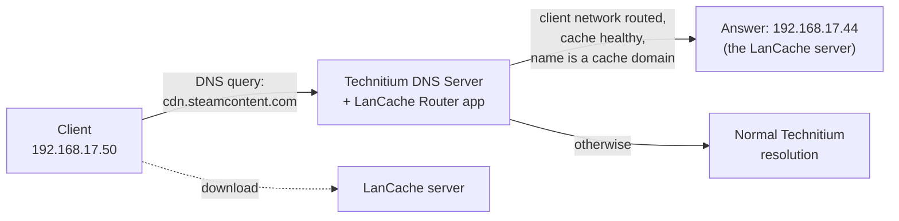

# LanCache Router – Wiki

LanCache Router is an app for the [Technitium DNS Server](https://technitium.com/dns/). It makes game-download
traffic (Steam, Epic, Battle.net, Windows Update, …) go through a [LanCache](https://lancache.net/) server, and it
does so **per client network** and **only while the cache is actually healthy**.

Plain DNS rewriting keeps handing out the cache address even when the cache is down. With this app the address simply
stops being handed out while the cache is unhealthy, and clients resolve the real CDN again.

## Where to start

| I want to… | Read |
|---|---|
| understand what the app does and why it exists | [1. Overview](01-overview.md) |
| understand exactly how a query is handled | [2. How it works](02-how-it-works.md) |
| install it and make a first working setup | [3. Installation](03-installation.md) |
| look up a setting and see how it changes behavior | [4. Configuration reference](04-configuration-reference.md) |
| decide which client network uses which cache | [5. Routing](05-routing.md) |
| tune health checking and failover | [6. Health checks](06-health-checks.md) |
| control which domains are cached | [7. Domain list](07-domain-list.md) |
| know what DNS answers look like on the wire | [8. DNS answers](08-dns-answers.md) |
| run it, read its logs, find out why a name is not cached | [9. Operations and troubleshooting](09-operations.md) |
| know what it cannot do (yet) | [10. Limitations and roadmap](10-limitations-and-roadmap.md) |

## The idea in one picture

## Design records

The reasoning behind the design lives in the [architecture decision records](../adr/README.md). The wiki describes what
the app does; the ADRs describe why. The [backlog](../backlog.md) lists what is deliberately not in version 1.
